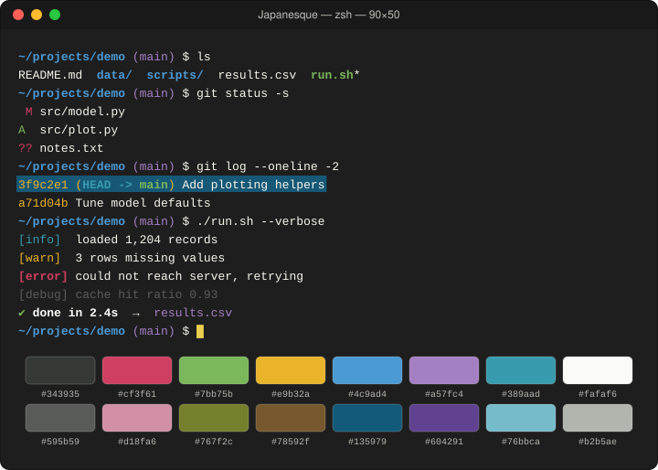
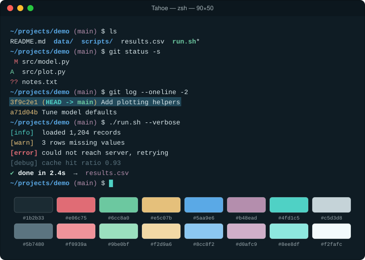
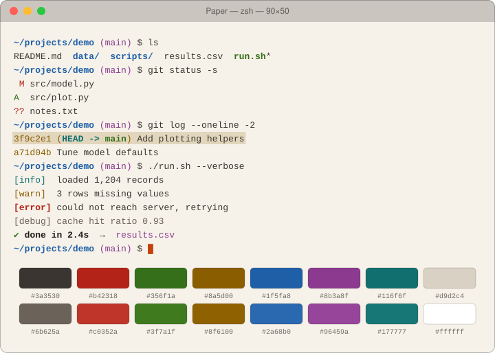

# Terminal color schemes

A collection of color schemes for macOS Terminal.app.

## Schemes

| Scheme | Background | Notes |
|---|---|---|
| [Japanesque](japanesque/) | `#1e1e1e` | Dark, warm palette with muted colors. My current default. |
| [Tahoe](tahoe/) | `#0f1c24` | Dark. Deep lake teal with granite grays and clear-water cyans. |
| [Ember](ember/) | `#1c1614` | Dark. Warm charcoal with copper, amber, and clay accents. |
| [Fjord](fjord/) | `#1b2230` | Dark. Cool blue-slate with soft, low-glare accents. |
| [Paper](paper/) | `#f6f2e9` | Light. Warm off-white paper with ink-like colors. |

## Previews

Each preview is drawn from the colors stored in the scheme's `.terminal` file, so it matches what Terminal shows.

### [Japanesque](japanesque/)



### [Tahoe](tahoe/)



### [Ember](ember/)


### [Fjord](fjord/)


### [Paper](paper/)



## Installing a scheme

1. Open the scheme's folder and download its `.terminal` file.
2. Double-click it (or go to Terminal → Settings → Profiles → ⋯ → Import).
3. Select the profile and click **Default**.

## Adding a scheme

Either export an existing profile from Terminal → Settings → Profiles → ⋯ → Export, or describe a new one in a `palette.json` (see [`tahoe/palette.json`](tahoe/palette.json)) and build the profile:

```sh
python3 tools/make_terminal.py myscheme/palette.json
```

Then render its preview, add a README to its folder, and add it to the table and previews above:

```sh
python3 tools/render_preview.py myscheme/MyScheme.terminal
```

Both tools use only the Python standard library.
