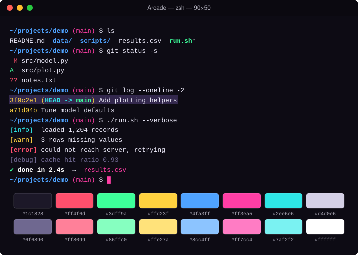

# Arcade

High-energy synthwave neon on near-black.

## Install

1. Download [`Arcade.terminal`](Arcade.terminal).
2. Double-click it (or Terminal → Settings → Profiles → ⋯ → Import).
3. Select **Arcade** and click **Default**.

## Palette

| Role | Normal | Bright |
|---|---|---|
| Black | `#1c1828` | `#6f6890` |
| Red | `#ff4f6d` | `#ff8099` |
| Green | `#3dff9a` | `#86ffc0` |
| Yellow | `#ffd23f` | `#ffe27a` |
| Blue | `#4fa3ff` | `#8cc4ff` |
| Magenta | `#ff3ea5` | `#ff7cc4` |
| Cyan | `#2ee6e6` | `#7af2f2` |
| White | `#d4d0e6` | `#ffffff` |

| Element | Color |
|---|---|
| Background | `#0d0b14` |
| Text | `#e8e6f5` |
| Bold text | `#ffffff` |
| Cursor | `#ff3ea5` |
| Selection | `#33284d` |

The profile is generated from [`palette.json`](palette.json) with `tools/make_terminal.py`.
