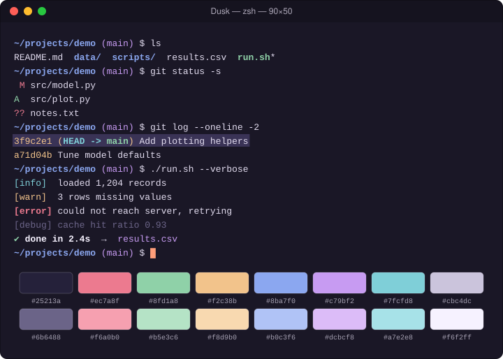

# Dusk

Twilight indigo with sunset rose, peach, and lavender.

## Install

1. Download [`Dusk.terminal`](Dusk.terminal).
2. Double-click it (or Terminal → Settings → Profiles → ⋯ → Import).
3. Select **Dusk** and click **Default**.

## Palette

| Role | Normal | Bright |
|---|---|---|
| Black | `#25213a` | `#6b6488` |
| Red | `#ec7a8f` | `#f6a0b0` |
| Green | `#8fd1a8` | `#b5e3c6` |
| Yellow | `#f2c38b` | `#f8d9b0` |
| Blue | `#8ba7f0` | `#b0c3f6` |
| Magenta | `#c79bf2` | `#dcbcf8` |
| Cyan | `#7fcfd8` | `#a7e2e8` |
| White | `#cbc4dc` | `#f6f2ff` |

| Element | Color |
|---|---|
| Background | `#1a1726` |
| Text | `#e2dcef` |
| Bold text | `#f6f2ff` |
| Cursor | `#ff9e7a` |
| Selection | `#3a3356` |

The profile is generated from [`palette.json`](palette.json) with `tools/make_terminal.py`.
