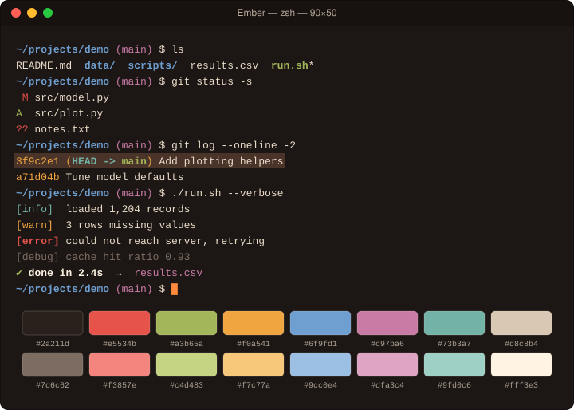

# Ember

Warm charcoal with copper, amber, and clay accents.

## Install

1. Download [`Ember.terminal`](Ember.terminal).
2. Double-click it (or Terminal → Settings → Profiles → ⋯ → Import).
3. Select **Ember** and click **Default**.

## Palette

| Role | Normal | Bright |
|---|---|---|
| Black | `#2a211d` | `#7d6c62` |
| Red | `#e5534b` | `#f3857e` |
| Green | `#a3b65a` | `#c4d483` |
| Yellow | `#f0a541` | `#f7c77a` |
| Blue | `#6f9fd1` | `#9cc0e4` |
| Magenta | `#c97ba6` | `#dfa3c4` |
| Cyan | `#73b3a7` | `#9fd0c6` |
| White | `#d8c8b4` | `#fff3e3` |

| Element | Color |
|---|---|
| Background | `#1c1614` |
| Text | `#eadbc8` |
| Bold text | `#fff3e3` |
| Cursor | `#ff8a3d` |
| Selection | `#4a3328` |

The profile is generated from [`palette.json`](palette.json) with `tools/make_terminal.py`.
