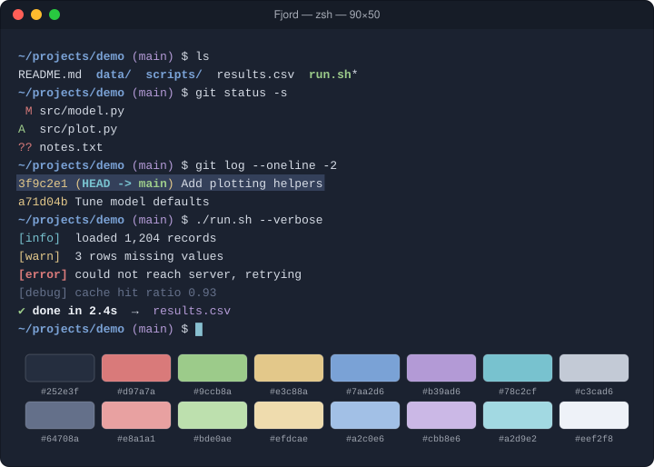

# Fjord

Cool blue-slate with soft, low-glare accents.

## Install

1. Download [`Fjord.terminal`](Fjord.terminal).
2. Double-click it (or Terminal → Settings → Profiles → ⋯ → Import).
3. Select **Fjord** and click **Default**.

## Palette

| Role | Normal | Bright |
|---|---|---|
| Black | `#252e3f` | `#64708a` |
| Red | `#d97a7a` | `#e8a1a1` |
| Green | `#9ccb8a` | `#bde0ae` |
| Yellow | `#e3c88a` | `#efdcae` |
| Blue | `#7aa2d6` | `#a2c0e6` |
| Magenta | `#b39ad6` | `#cbb8e6` |
| Cyan | `#78c2cf` | `#a2d9e2` |
| White | `#c3cad6` | `#eef2f8` |

| Element | Color |
|---|---|
| Background | `#1b2230` |
| Text | `#d5dbe5` |
| Bold text | `#eef2f8` |
| Cursor | `#88c0d0` |
| Selection | `#34405a` |

The profile is generated from [`palette.json`](palette.json) with `tools/make_terminal.py`.
