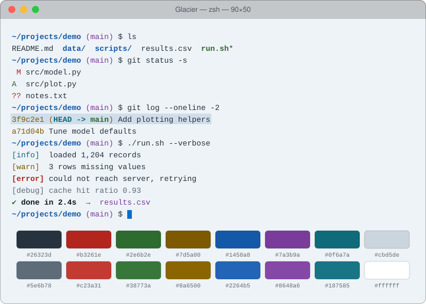

# Glacier

Light theme: cool blue-white ice with deep, crisp colors.

## Install

1. Download [`Glacier.terminal`](Glacier.terminal).
2. Double-click it (or Terminal → Settings → Profiles → ⋯ → Import).
3. Select **Glacier** and click **Default**.

## Palette

| Role | Normal | Bright |
|---|---|---|
| Black | `#26323d` | `#5e6b78` |
| Red | `#b3261e` | `#c23a31` |
| Green | `#2e6b2e` | `#38773a` |
| Yellow | `#7d5a00` | `#8a6500` |
| Blue | `#1458a8` | `#2264b5` |
| Magenta | `#7a3b9a` | `#8648a6` |
| Cyan | `#0f6a7a` | `#187585` |
| White | `#cbd5de` | `#ffffff` |

| Element | Color |
|---|---|
| Background | `#eef3f7` |
| Text | `#26323d` |
| Bold text | `#111a22` |
| Cursor | `#0b6bcb` |
| Selection | `#cfdeea` |

The profile is generated from [`palette.json`](palette.json) with `tools/make_terminal.py`.
