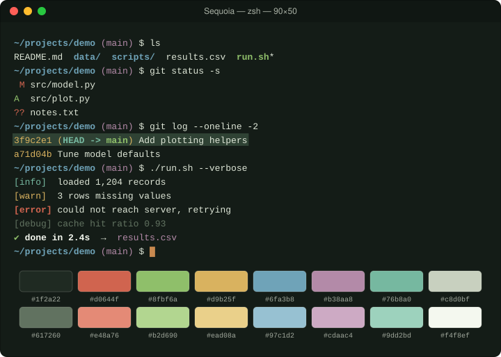

# Sequoia

Dark forest green with redwood bark, moss, and morning-fog accents.

## Install

1. Download [`Sequoia.terminal`](Sequoia.terminal).
2. Double-click it (or Terminal → Settings → Profiles → ⋯ → Import).
3. Select **Sequoia** and click **Default**.

## Palette

| Role | Normal | Bright |
|---|---|---|
| Black | `#1f2a22` | `#617260` |
| Red | `#d0644f` | `#e48a76` |
| Green | `#8fbf6a` | `#b2d690` |
| Yellow | `#d9b25f` | `#ead08a` |
| Blue | `#6fa3b8` | `#97c1d2` |
| Magenta | `#b38aa8` | `#cdaac4` |
| Cyan | `#76b8a0` | `#9dd2bd` |
| White | `#c8d0bf` | `#f4f8ef` |

| Element | Color |
|---|---|
| Background | `#141c17` |
| Text | `#dde5d6` |
| Bold text | `#f4f8ef` |
| Cursor | `#c9894f` |
| Selection | `#2f4234` |

The profile is generated from [`palette.json`](palette.json) with `tools/make_terminal.py`.
